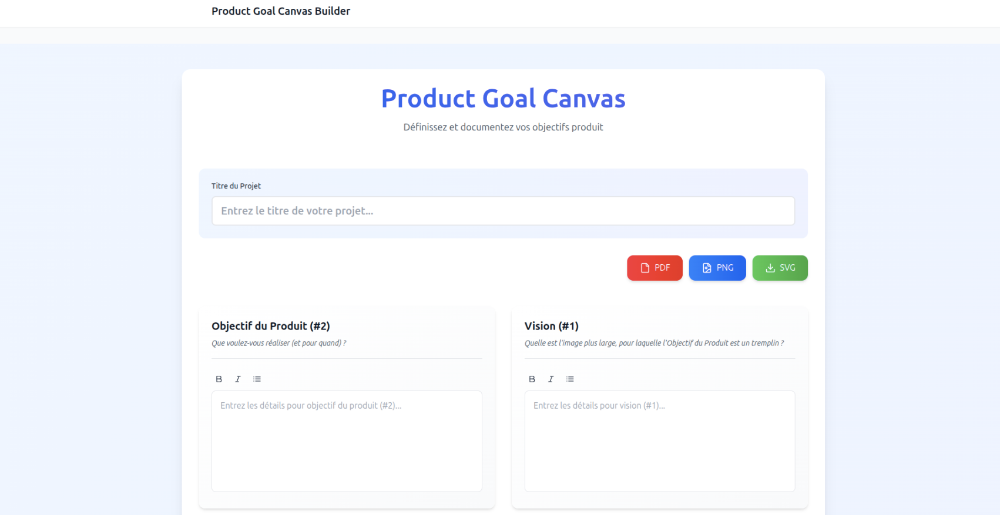

## Product Goal Canvas Builder

Application web permettant de **concevoir, documenter et exporter un Product Goal Canvas** moderne, basée sur React, TypeScript, Vite et Tailwind CSS.



### Aperçu

- **Canvas interactif** pour définir :
  - Vision du produit
  - Objectif du produit
  - Description / narratif
  - Résultats précieux & mesures
  - Parties prenantes (utilisateur, influenceur, fournisseur, gouvernance interne/externe)
  - Risques
  - Équipe Scrum (Product Owner, Développeurs, Scrum Master)
- **Titre de projet personnalisable**
- **Export du canvas** en :
  - **PDF**
  - **PNG**
  - **SVG**
- UI moderne, responsive, avec Tailwind CSS

---

## Stack technique

- **React 18**
- **TypeScript**
- **Vite 5**
- **Tailwind CSS 3**
- **html-to-image** (conversion du canvas en image)
- **jsPDF** (génération de PDF)
- **lucide-react** (icônes)

---

## Prérequis

- **Node.js** ≥ 18 recommandé
- **npm** ou **yarn** installé

---

## Installation

Dans le dossier du projet `Product-Goal-Canvas` :

```bash
# avec npm
npm install

# ou avec yarn
yarn install
```

---

## Scripts disponibles

Dans le fichier `package.json` :

- **Démarrer en développement**

```bash
npm run dev
# ou
yarn dev
```

Puis ouvrir le navigateur sur l’URL indiquée par Vite (par défaut `http://localhost:5173`).

- **Build de production**

```bash
npm run build
# ou
yarn build
```

- **Prévisualisation du build**

```bash
npm run preview
# ou
yarn preview
```

- **Lint (ESLint)**

```bash
npm run lint
# ou
yarn lint
```

---

## Utilisation

1. Lancer l’application avec `npm run dev` ou `yarn dev`.
2. Saisir le **titre du projet** dans le champ dédié.
3. Compléter chaque section du **Product Goal Canvas** :
   - Vision, Objectif du Produit, Description, Résultats & Mesures, Parties Prenantes, Risques, Équipe Scrum.
4. Une fois le canvas complété, utiliser les boutons :
   - **PDF** : export du canvas en fichier PDF.
   - **PNG** : export du canvas en image PNG.
   - **SVG** : export du canvas en image vectorielle SVG.

Les exports utilisent `html-to-image` et `jsPDF` pour capturer le canvas et générer les fichiers téléchargeables.

---

## Structure principale du code

- `src/App.tsx` : point d’entrée de l’UI, intègre le `ProductGoalCanvas`.
- `src/components/ProductGoalCanvas.tsx` : logique principale du canvas (état, exports PDF/PNG/SVG, titre du projet, layout).
- `src/components/CanvasSection.tsx` : composant pour chaque section du canvas.
- `src/types.ts` : définitions TypeScript du modèle de données du canvas.

---

## Personnalisation

- **Styles / design** : modifiables via Tailwind CSS (`tailwind.config.js`) et les classes utilitaires dans les composants React.
- **Sections du canvas** : ajout/suppression/modification dans `ProductGoalCanvas.tsx` et `types.ts`.
- **Texte & langue** : tous les libellés sont actuellement en français, modifiables directement dans les composants.

---

## Auteur

Développé avec ❤️ par **Ismail MOUYAHADA**.  
Si vous appréciez ce projet, vous pouvez le soutenir via le bouton de don intégré (Buy Me a Coffee).

## Deploy

[](https://vercel.com/new/clone?repository-url=https%3A%2F%2Fgithub.com%2Fghostland-dev%2Fproduct-goal-canvas)

Click the button to deploy your own copy on Vercel in one step.

## Author

**Ismail.M**, Software Engineer & DevOps

- GitHub: [@ghostland-dev](https://github.com/ghostland-dev)
- Website: [ismail-mouyahada.com](https://www.ismail-mouyahada.com)
